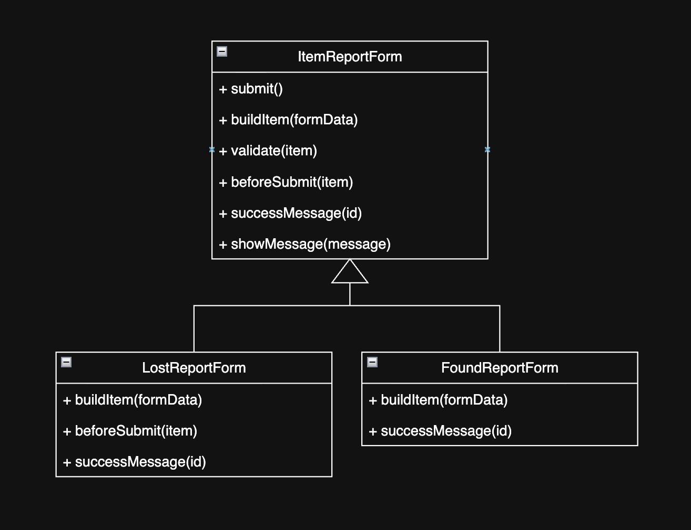

# D5 - Design

## 1. Description

The NAU Lost and Found System is a web application that helps students, faculty, and staff on the NAU Flagstaff Mountain Campus recover lost belongings without the building-by-building guesswork of traditional lost and found desks. Community members report what they lost, choosing a category and the campus building where it was last seen, and then follow their reports from a personal inbox that shows each report’s status. Trusted staff log items that are turned in and manage the found-item inventory, which stays private: instead of browsing every found item, community members are shown only the few items that likely match their own reports, with limited details, so that nobody can claim an item that isn’t theirs. When a match is confirmed, the item is held for its owner, and staff verify the owner’s identity when the item is picked up.

The system is built as a single Node.js application with clearly separated layers. The user interface is a set of plain HTML, CSS, and JavaScript pages that run in the browser and communicate with the server only through a JSON REST API (/api/v1). The API is written with Express, with each group of routes in its own module (items, reference data such as categories and the campus buildings, and lost/found matching), and all data is stored in a single SQLite database accessed through a small database module that also runs the schema migrations. For this release, sign-in is a demonstration login that distinguishes community members from staff in the browser; signing in with NAU CAS credentials, automatic matching of lost reports against found items, claiming and pickup, item photos, and a campus map of item locations are planned or in progress, and the design described in this document is intended to accommodate them.

## 2. Architecture

### Package Diagram:

### Rationale:

## 3. Class Diagram

### Diagram:

### Notes:

## 4. Sequence Diagram

### Use Case Description:

**Use case:**

**Actor(s):**

**Preconditions:**

**Main flow:**

1.

**Alternative flows:**

**Postconditions:**

### Diagram:

## 5. Design Patterns

### 5.1 Pattern Name: Template Method

#### Problem:

The forms for reporting lost items and found items use the same API. Both forms collect item information from the user, send it to a shared API, receive the result from it, and display it on the screen.

Since they communicate data with the same backend, sharing the same submission approach would be more efficient for maintenance and/or modifications than keeping separate code individually.

So, we applied the 'Template Method' design pattern, which allows the two forms to share a unified submission process while still accommodating their specific differences.

#### Class Diagram:

#### Roles and Implementation:

`ItemReportForm` serves as the abstract parent class.
The `submit()` method within this class acts as the **template method**. It directs the submission process in this order: reading form data, creating an item object, validating required fields, performing pre-submission checks, send data to the API, and displaying the result.

`LostReportForm` and `FoundReportForm` function as concrete subclasses.

- `LostReportForm` implements `buildItem()` to create a "lost item" object and overrides `beforeSubmit()` to execute a check for existing duplicate entries. - `FoundReportForm` implements `buildItem()` to create an item object, while utilizing the default `beforeSubmit()` method from the parent class.
- Both subclasses override `successMessage()` to display a message appropriate for the specific type of report.

By designing it this way, both submissions now trigger a common workflow upon form submission, without requiring any changes to the existing unique logic.

- `public/js/itemReportForm.js` : Template methods and common submission workflow
- `public/js/reportPage.js` : Implementation of `LostReportForm`
- `public/js/reportFoundItem.js` : Implementation of `FoundReportForm`

### 5.2 Pattern Name:

#### Problem:

#### Class Diagram:

#### Roles and Implementation:

## 6. Design Principles

### 6.1 Principle Name:

#### Principle:

#### Example:

#### Benefit:

### 6.2 Principle Name:

#### Principle:

#### Example:

#### Benefit:
