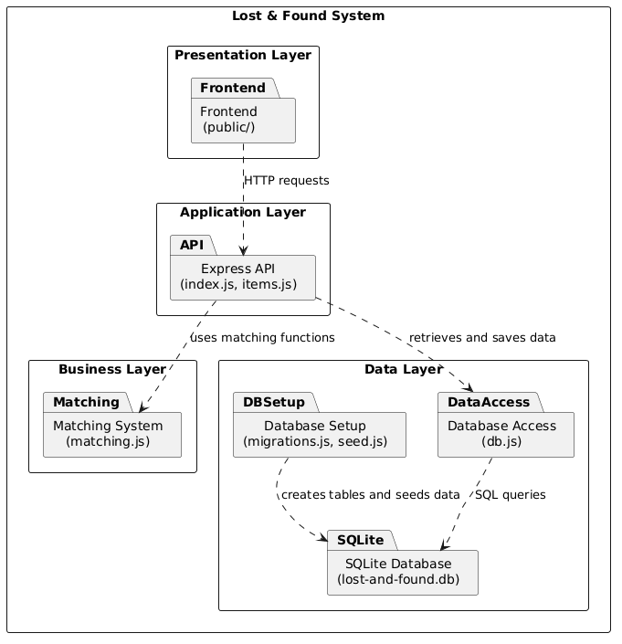
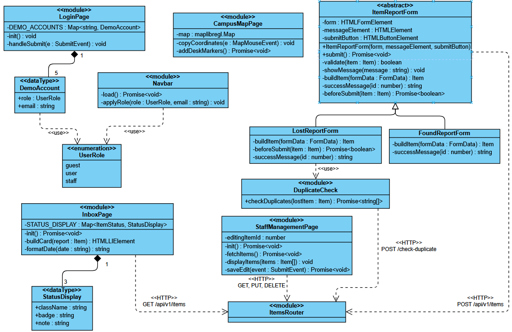
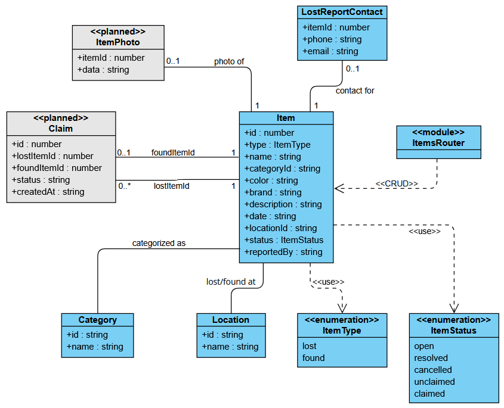
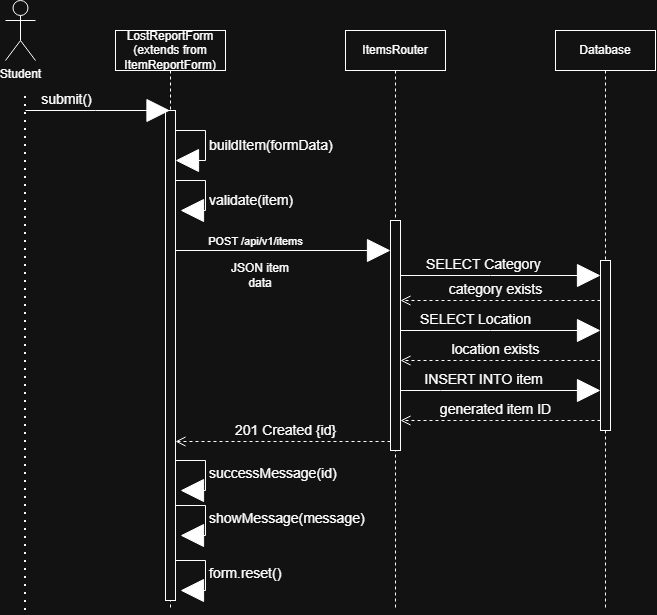
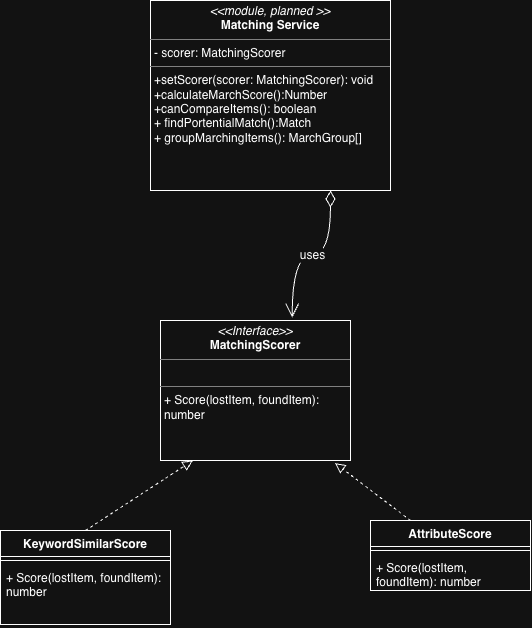

# D5 - Design

## 1. Description (Brennan)

The NAU Lost and Found System is a web application that helps students, faculty, and staff on the NAU Flagstaff Mountain Campus recover lost belongings without the building-by-building guesswork of traditional lost and found desks. Community members report what they lost, choosing a category and the campus building where it was last seen, and then follow their reports from a personal inbox that shows each report’s status. Trusted staff log items that are turned in and manage the found-item inventory, which stays private: instead of browsing every found item, community members are shown only the few items that likely match their own reports, with limited details, so that nobody can claim an item that isn’t theirs. When a match is confirmed, the item is held for its owner, and staff verify the owner’s identity when the item is picked up.

The system is built as a single Node.js application with clearly separated layers. The user interface is a set of plain HTML, CSS, and JavaScript pages that run in the browser and communicate with the server only through a JSON REST API (/api/v1). The API is written with Express, with each group of routes in its own module (items, reference data such as categories and the campus buildings, and lost/found matching), and all data is stored in a single SQLite database accessed through a small database module that also runs the schema migrations. For this release, sign-in is a demonstration login that distinguishes community members from staff in the browser; signing in with NAU CAS credentials, automatic matching of lost reports against found items, claiming and pickup, item photos, and a campus map of item locations are planned or in progress, and the design described in this document is intended to accommodate them.

## 2. Architecture (Amaya)

### Package Diagram:

### Rationale:
Our Lost and Found system uses a layered architecture to separate the frontend, application, business, and database. We chose this design to keep the different parts of the system organized and make it easier to update as the project grows.

The **Presentation Layer** contains the HTML, CSS, and JavaScript files. It is responsible for displaying the website and allowing users to submit and search for lost and found items.

The **Application Layer** contains the Express API, including `index.js` and `items.js`. It handles requests from the frontend and connects the different parts of the system.

The **Business Layer** contains `matching.js`. This module compares lost and found reports, calculates match scores, and groups items that may belong together.

The **Data Layer** contains `db.js`, the database setup files, and the SQLite database. It handles storing and retrieving information.

We chose this architecture because it improves maintainability and testability. Separating the system into layers makes it easier to work on one part without having to change the entire system. It also makes it easier to test individual parts, such as the matching system. This design also helps with security because the frontend communicates with the backend API instead of accessing the database directly.

One alternative we considered was putting most of the code into one large file. This might have been simpler when starting the project, but it would make the system harder to organize, test, and maintain as more features are added. We decided that a layered architecture would work better for our project as it continues to grow.

## 3. Class Diagram (Brennan)

### Diagram:

#### Broswer Model (public/)

#### Server Model (backend/)

#### Data model (database)

### Notes:

Our project is written mostly in javascript without following typical OOP structure. As such, the diagram was designed as such to best fit our codebase. 

Some conventions are worth pointing out here for clarity:
- To fit better and be more readable, the model is split into three parts; public, backend, and database, all connected through the ItemsRouter module.
- <\<module>> refers to a JS file that does not define a class. Its attributes are all module-level variables/functions.
- <\<planned>> refers to something that is not currently fully/partially implemented in the codebase, but is in development or will be soon.
- '+' refers to global attributes.
- '-' refers to local or subclass only attributes.

## 4. Sequence Diagram (Jake)

### Use Case Description:

**Use case:**
Submit a Lost Item Report as a Student

**Actor(s):** 
Student

**Preconditions:**
The student can access the NAU Lost & Found application

**Main flow:**

1. The student logs into the NAU Lost & Found.
2. The student opens the report lost item page.
3. The student enters in the item name, category, date lost, last known location, description, and the brand of the item. 
4. The student submits the lost item report.
5. The system receives and validates the form data and creates a lost item object.
6. The system sends the item information to the backend API.
7. The backend verifies that the selected category and the selected location exists.
8. The backend saves the lost item report and the info of the user who submitted it.
9. The backend returns a brand new generated item id for the submitted item.
10. The system displays a confirmation message showing the item ID and resets the form.

**Alternative flows:**
- 5a. __Missing required information:__ If any of the required fields are not filled out, the system displays a message to the user and does not submit the report.
- 7a. __Invalid category or location:__ If the selected category or location does not exist, the backend rejects the item submission.

**Postconditions:**
- When completed, the lost item report and information of the one who submitted the report are stored in the databaes.
- The student recieves a confirmation message showing the geenrated item ID.
### Diagram:

## 5. Design Patterns

### 5.1 Pattern Name: Template Method (Lareine)

#### Problem:

The forms for reporting lost items and found items use the same API. Both forms collect item information from the user, send it to a shared API, receive the result from it, and display it on the screen.

Since they communicate data with the same backend, sharing the same submission approach would be more efficient for maintenance and/or modifications than keeping separate code individually.

So, we applied the 'Template Method' design pattern, which allows the two forms to share a unified submission process while still accommodating their specific differences.

#### Class Diagram:

#### Roles and Implementation:

`ItemReportForm` serves as the abstract parent class.
The `submit()` method within this class acts as the **template method**. It directs the submission process in this order: reading form data, creating an item object, validating required fields, performing pre-submission checks, send data to the API, and displaying the result.

`LostReportForm` and `FoundReportForm` function as concrete subclasses.

- `LostReportForm` implements `buildItem()` to create a "lost item" object and overrides `beforeSubmit()` to execute a check for existing duplicate entries. - `FoundReportForm` implements `buildItem()` to create an item object, while utilizing the default `beforeSubmit()` method from the parent class.
- Both subclasses override `successMessage()` to display a message appropriate for the specific type of report.

By designing it this way, both submissions now trigger a common workflow upon form submission, without requiring any changes to the existing unique logic.

- `public/js/itemReportForm.js` : Template methods and common submission workflow
- `public/js/reportPage.js` : Implementation of `LostReportForm`
- `public/js/reportFoundItem.js` : Implementation of `FoundReportForm`

### 5.2 Pattern Name: Strategy Pattern (Evelyn)

#### Problem:

The planned `Matching` module must score how well a lost item matches a found item. Attributes and keyword text similarity will need to be measured and they will likely be tuned or replaced as the system evolves. If `calculateMatchScore()` hard-codes one algorithm, every change means editing `Matching`. Extracting the scoring algorithm behind a common interface makes algorithms interchangeable, so they can be swapped or added without touching `Matching`. 

#### Class Diagram: 

#### Roles and Implementation:

`Matching` serves as the context. It keeps a reference to a `MatchScorer` and delegates the scoring work to it. `calculateMatchScore()`, `findPotentialMatch()`, and `groupMatchingItems()` all rely on the selected scorer instead of containing their own scoring logic.

`MatchScorer` is the strategy interface. It declares a single method, `score(lostItem, foundItem)`, which returns a number for how well a lost item matches a found item.

`KeywordSimilarScorer` and  `AttributeScorer` are the concrete strategies.

- `AttributeScorer` scores items higher when they share the same attributes.
- `KeywordSimilarScorer` compares the name and description text of the two items.

The scorer is selected with `Matching.setScorer()`, so a new algorithm only requires a new `MatchScorer` class. `Matching` and the existing scorers do not change.

- `backend/matching/matching.js`: `Matching` Context
- `backend/matching/scorers/matchScorer.js`: `MatchScorer` Strategy interface
- `backend/matching/scorers/attributeScorer.js`: Concrete Strategies 
- `backend/matching/scorers/ KeywordSimilarScorer.js` : Concrete Strategies

## 6. Design Principles (Rose)

### 6.1 Principle Name: Don't Repeat Yourself (DRY)

#### Principle:
The theory behind the DRY principle is that code used in more than one place
should be defined in a centralized manner (e.g a common function) and called
from all areas where it is used. This ensures that different versions of the
same code do not drift out of sync over time and cause inconsistent behavior.

#### Example:
Our website uses a shared header on every page with additional behavior
derived from our placeholder authentication system. Replicating this layout
and behavior on every page would cause significant code duplication, and would
cause significant complications when trying to add a new page or change
existing header behavior. For that reason, the header was moved into its own
file in [public/components/navbar.html](https://github.com/bs2863/CS386-Project-LostAndFound/blob/main/public/components/navbar.html).

#### Benefit:
Having the header in its own file that is then imported by every other page
ensures that the header remains consistent in styling and behavior across all
pages. It also makes adding new links and behavior to the header much simpler,
as the change only needs to be made in one place and it will propagate across
all other pages.

### 6.2 Principle Name: Dependency Inversion (D of SOLID)

#### Principle:
The dependency inversion principle states that both high-level and low-level
classes should depend upon interfaces, rather than upon each other directly.

#### Example:
While our project does not make particularly extensive use of classes, we
first started designing our frontend and backend around the interface between
them: that is, the API endpoints needed, and the data they would serve. We
built the frontend around [public/data/mockData.json](https://github.com/bs2863/CS386-Project-LostAndFound/tree/main/public/data/mockData.json),
built the backend to provide the same data format, and only then connected
the two. 

#### Benefit:
Using a mock data interface prior to implementing the relevant backend endpoints
had several benefits. It allowed us to iterate on the frontend and backend
independently, by serving the mock data file instead of a real HTTP response.
It gave us preexisting mock data for use in API tests, and a baseline to compare
responses against. Lastly, in the event part of the API needs to be revised,
we will already have a clear expectation of the interface it should provide,
allowing us to refactor the API without matching implementation details exactly.
