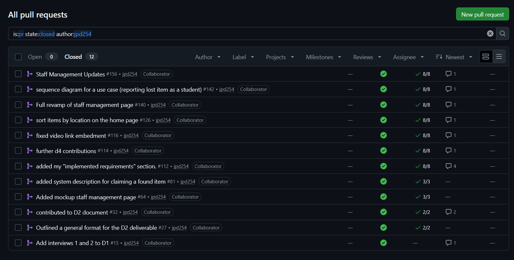
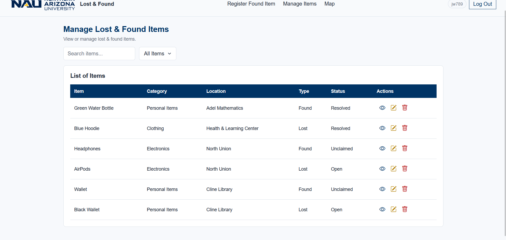
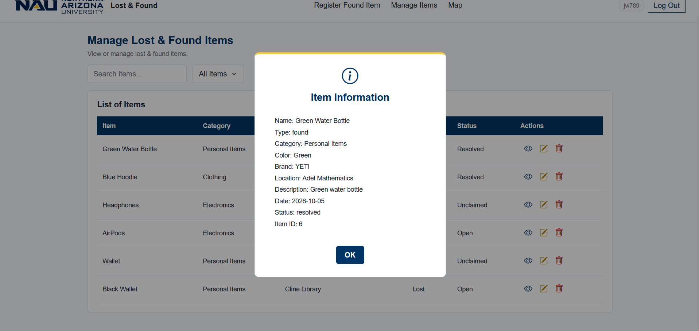
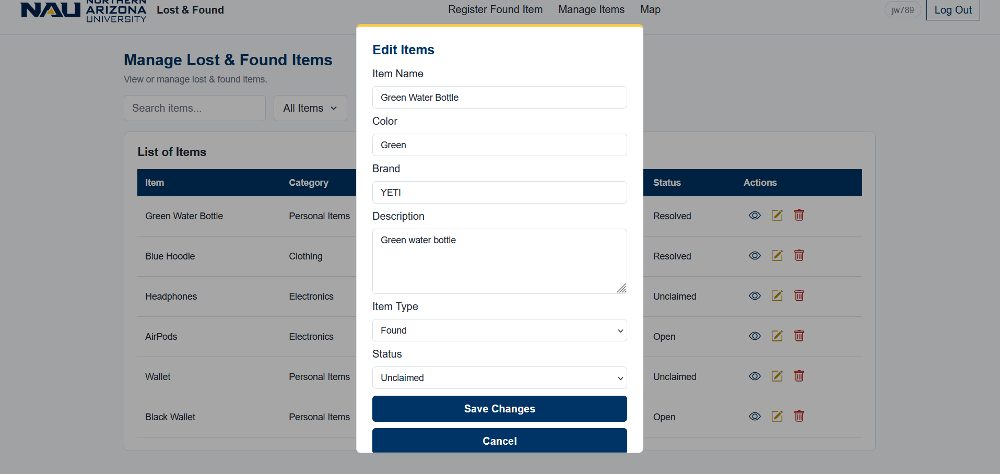
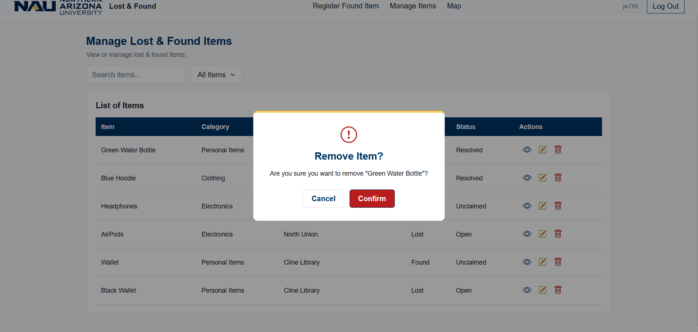

# D6 - Implementation 2

## 1. Introduction

### Description

The NAU Lost and Found System is a web application that helps students, faculty, and staff on the NAU Flagstaff Mountain Campus recover lost belongings without the building-by-building guesswork of traditional lost and found desks. Community members report what they lost, choosing a category, a campus zone, and the building where it was last seen, and then follow their reports from a personal inbox that shows each report's status. Trusted staff log items that are turned in and manage the found-item inventory, which stays private: instead of browsing every found item, community members are shown only the few items that likely match their own reports, with limited details, so that nobody can claim an item that isn't theirs. When a community member claims a match, the item is held for them at the building where it was found, and staff verify the owner's identity when the item is picked up.

### Value Proposition

The NAU Lost and Found System helps NAU students and staff recover lost belongings without the building-by-building guesswork of typical lost and found desks. Instead of running all over campus, users file one report, and the web app automatically matches it against items already turned in and shows the likely matches in their inbox, while the rest of the inventory remains private.

### Minimum Viable Product (MVP)

The MVP supports the full path of a lost item, from the first report to its return:

1. **Sign in by role.** A demonstration login distinguishes community members from staff and shows each role only the pages it may use.
2. **Report a lost item.** A community member describes the item (name, category, color, brand, description, date) and picks where it was lost by first choosing a campus zone and then a building in that zone. The system warns about likely duplicate reports before saving.
3. **Log a found item.** Staff record items that are turned in, using the same zone and building selection.
4. **Track reports in an inbox.** The home page lists the signed-in member's reports with a status: Searching, Matches found, or Ready for pickup, with closed reports (Picked up or Cancelled) collapsed in their own section.
5. **Review likely matches.** The system scores each open report against unclaimed found items (category, name, color, brand, building, description, and date) and shows the best matches with limited details only: name, category, building, and date found.
6. **Claim a match.** Claiming holds the found item for the member, and the report shows the building where it can be picked up.
7. **Close a report.** Staff mark a held item as picked up, or the member cancels a report they no longer need; either way the report moves to the closed section.
8. **Manage the inventory (staff).** Staff view, filter, edit, and remove lost and found items.
9. **Campus map.** A map of the campus shows where the lost and found desks are.

### What Changed and Why

- **The MVP now keeps found items private and matches them to reports.** In D2 the MVP was a public list of found items that users filtered until they found theirs, which contradicted our own value proposition (automatic matching with a private inventory). Showing every found item also lets anyone describe and claim an item that isn't theirs. The MVP now follows the value proposition: users see only their likely matches, with limited details.
- **Claiming and pickup were added.** Once found items are private, the user needs a way to say "this one is mine" and staff need a way to verify it, so the MVP gained a claim step that holds the item and a pickup step where staff check ID.
- **An inbox replaced notifications.** The value proposition promised to notify users of matches. Instead of email notifications, the inbox shows each report's status the next time the user visits, which needs no email service for the prototype. This was much simpler to implement and made for a convenient homepage for the webapp.
- **Buildings are chosen by zone.** Choosing from a single list of every campus building was slow, so the buildings are grouped into campus zones, which also lets matching be extended to nearby buildings later.

### Repository

The repository for this project is located at [bs2863/CS386-Project-LostAndFound](https://github.com/bs2863/CS386-Project-LostAndFound).

## 2. Implemented Requirements

### 2.1 Brennan Smith (@bs2863)

#### Pull requests

#### Requirements

### 2.2 Lareine Han (@AwesomeYeti)

#### Pull requests

#### Requirements

### 2.3 Rose Hankins (@az-raven)

#### Pull requests

#### Requirements

### 2.4 Evelyn Torres (@evetor419)

#### Pull requests

#### Requirements

### 2.5 Amaya Gillison (@amayajg)

#### Pull requests

#### Requirements

### 2.6 Jake Domabyl (@jpd254)

#### Pull requests
[All PRs by jpd254](https://github.com/bs2863/CS386-Project-LostAndFound/pulls?q=is%3Apr+state%3Aclosed+author%3Ajpd254)

#### Requirements

**As a campus community member, I want to search for lost items in one centralized place so that I can avoid going to the wrong location.**
(User story pulled from D2)
**Pull Requests**
- [#140](https://github.com/bs2863/CS386-Project-LostAndFound/pull/140)
- [#156](https://github.com/bs2863/CS386-Project-LostAndFound/pull/156)
**Issues:**
- [`#131`](https://github.com/bs2863/CS386-Project-LostAndFound/issues/131)
- [#61](https://github.com/bs2863/CS386-Project-LostAndFound/issues/61)
**Author**
- Jake Domabyl: Designed the staff management page and connected the backend to pull data from the database
**Reviewer**
- Rose Hankins @az-raven
**Automated Tests**
- [items.test.js](https://github.com/bs2863/CS386-Project-LostAndFound/blob/main/backend/tests/items.test.js): GET items to check if items reported are appearing.
**Visual Evidence**

**As someone that is all over campus regularly, I want to be able to sort lost items by the area that they were found in so that I can narrow my search.**
(User story pulled from D2)
**Pull Requests**
- [#126](https://github.com/bs2863/CS386-Project-LostAndFound/pull/126)
**Issues**
- [#55](https://github.com/bs2863/CS386-Project-LostAndFound/issues/55)
**Author**
- Jake Domabyl: Added a search bar to be able to sort by specific location
- Lareine Han: Added all of the locations that will be represented in the database
**Reviewer**
- Lareine Han @AwesomeYeti
**Automated Tests**
- [items.test.js](https://github.com/bs2863/CS386-Project-LostAndFound/blob/main/backend/tests/items.test.js): GET items to check if items reported are appearing.
- [api.test.js](https://github.com/bs2863/CS386-Project-LostAndFound/blob/main/backend/tests/api.test.js): GET item search and filter tests.
**Visual Evidence**
.png)
.png)
.png)

**As an NAU faculty member, I want to be able to add and manage information about found belongings so that students can search for their lost items more efficiently.**
(User story pulled from D2)
**Pull Requests**
- [#64](https://github.com/bs2863/CS386-Project-LostAndFound/pull/64)
- [#140](https://github.com/bs2863/CS386-Project-LostAndFound/pull/140)
- [#156](https://github.com/bs2863/CS386-Project-LostAndFound/pull/156)
**Issues:**
- [`#131`](https://github.com/bs2863/CS386-Project-LostAndFound/issues/131)
- [#56](https://github.com/bs2863/CS386-Project-LostAndFound/issues/56)
**Author**
- Jake Domabyl: Added functionality for the management of data thats already in the database. Made sure the page updates and represents accurately.
- Brennan Smith: Added new attributes for items registered into the database and did some CSS work on the page to make it more visually appealing.
**Reviewer**
- Rose Hankins @az-raven
**Automated Tests**
- [items.test.js](https://github.com/bs2863/CS386-Project-LostAndFound/blob/main/backend/tests/items.test.js): GET items to check if items reported are appearing.
**Visual Evidence**

**As a campus community member, I want to update or remove a lost item report, so that the information stays accurate if I find my item.**
(User story pulled from D2)
**Pull Requests**
- [#140](https://github.com/bs2863/CS386-Project-LostAndFound/pull/140)
- [#156](https://github.com/bs2863/CS386-Project-LostAndFound/pull/156)
**Issues:**
- [#45](https://github.com/bs2863/CS386-Project-LostAndFound/issues/45)
**Author**
- Jake Domabyl: Added the functionality for updating or outright removing an item from the database. Also made sure the page reflects updated information.
**Reviewer**
- Rose Hankins @az-raven
**Automated Tests**
- [items.test.js](https://github.com/bs2863/CS386-Project-LostAndFound/blob/main/backend/tests/items.test.js): GET items to check if items reported are appearing.
**Visual Evidence**

## 3. Automated Testing

### 3.1 Unit Tests

#### Test framework

#### Test location

#### Unit test example

##### Class under test

##### Test file

##### What is tested and what is mocked

##### Code snippet (arrange, act, assert)

#### Test results

### 3.2 Integration Tests

#### Test framework and tools

#### Test location

#### Integration scenario

#### Integration test example

##### Test file

##### Components under test

##### What integration is tested

##### Code snippet

#### Test results

### 3.3 Acceptance Tests

#### Testing tools

#### Test location

#### Acceptance test example

##### User story and acceptance criteria

##### Test scenario

##### Expected outcomes

##### Test file

##### Code snippet or test steps

#### Test execution evidence

## 4. System Demonstration

### Video link

### Scenario

## 5. AI-Assisted Code Quality Review

#### AI Feedback

#### Assigned Reviewer
Brennan Smith

#### Severity Assessment

#### Decision

#### Explanation

#### Tool Used

#### Prompt Engineering

#### Conversation Link

<!-- DIVIDER -->
---
#### Context Provided
As our codebase is relatively large and I wanted the AI to stay within scope of what I want reviewed, so I sent the following files as context to the Chat GPT model that I used.
- staffManagementPage.html
- staffManagement.js
- items.js

#### Tool Used
Chat GPT model GPT-6

#### Prompt Engineering
### Prompt 1

Hello bot, I am taking a software engineering class and as a part of the assignment I am currently working on I need to send you some of the code in the codebase that we have been working on for AI review. 

I am providing three core source files from my team's NAU Lost & Found application, a Node.js and Express application using SQLite. Take a look at the three provided files for what I have been working on the most in the project and consider their responsibilities and interactions within the application. This page is meant to be used as a staff member only. When logged in as a staff member, the user can add/edit/remove items in the database however they please in order to keep track of information and stay on top of things.

(I provided the actual files to the AI reviewer but omitted them for the deliverable as not to make the page unreadable)
staffManagementPage.html
staffManagement.js
items.js

With the context provided, conduct a comprehensive review covering the following:
- Architecture
- Design
- Code Quality
- Reliablitiy

Prioritize meaningful issues over minor stylistic preferences and for each issue that you raise, focus entirely on the source code provided. Do not ask follow up questions, but also do not invent problems to increase the number of suggestions.  

### Prompt 2
Now approach the same exact codebase but conduct a second review that is particularly focused on issues that may have been overlooked in the first prompt. 
Please review and provide context on the following:
- Dependencies between components
- Inconsistent implementation patterns
- Error handling

Same as before, prioritize meaningful issues over smaller issues. Also, provide the result in the same format as before.

### Detailed Analysis & Response 1
#### AI Feedback
Directly copied from Chat GPT:

The items.js file handles several different responsibilities, including:
- Retrieving and filtering items.
- Creating, updating, and deleting items.
- Checking for duplicate reports.
- Finding potential matches.
- Processing item claims.
- Handling item pickups and cancellations.
Although these operations are related to items, putting all of them into one router makes the file increasingly difficult to maintain as the application grows.

For example, the claim and pickup functionality involves multiple database operations and business rules, while retrieving items is primarily a read operation.

Recommendation: Consider separating some of these responsibilities into additional route files or service modules. For example, claim-related functionality could be moved into a separate module. This would make the code easier to navigate, test, and maintain without fundamentally changing the application's architecture.

#### Assigned Reviewer
Jake Domabyl

#### Severity Assessment
Medium

#### Decision
[Rejected]

#### Explanation
I decided not to implement anything regarding the AIs suggestion in this instance. Considering all of our intended funcitonality is already achieved, I do not see a reason to go back and refactor a large and important portion of the code base. I fully understand what it is saying and why having one file handle so many different responsibilities can be confusing the longer a project goes on and grows, but at this point in the project I believe its current state is entirely durable.

### Detailed Analysis & Response 2
#### AI Feedback
Directly copied from Chat GPT:

Failed item retrieval does not provide feedback to staff.
In staffManagement.js, the fetchItems() function catches errors and 
logs them to the console:
`catch (error) {
    console.error('Failed to load staff items: ', error);
}`

This is useful for debugging, but it does not provide any visible feedback to the staff member using the application.

If the database request fails, the staff member might simply see an empty table or previously loaded information without knowing that something went wrong.

Recommendation: Display an appropriate error message in the interface when item retrieval fails. This would make the application more transparent and help staff distinguish between an empty database and a failed request.
#### Assigned Reviewer
Jake Domabyl

#### Severity Assessment
Medium

#### Decision
[Accepted]

#### Explanation
I think this is actually a very good recommendation. I think the more feedback the user recieves for a certain piece of the codebase not working as intended the better. I'd like to update this portion of the codebase to show the user what exactly failed when retrieving data.

### Detailed Analysis & Response 3
#### AI Feedback
Directly copied from Chat GPT:

The frontend repeats similar API request handling.
The frontend contains several blocks of similar code for communicating with the backend.

For example, updating, deleting, and marking items as picked up all follow a similar pattern:
1. Send a fetch() request.
2. Check whether the response was successful.
3. Extract an error if something went wrong.
4. Display a popup.
5. Refresh the item list.
This repetition is not necessarily incorrect, but it can make future maintenance more difficult. If the application's error-handling behavior changes, multiple sections may need to be updated individually.

Recommendation: Consider creating a small reusable API helper function to handle common request and error-handling behavior. This would reduce duplicated code and make the frontend easier to maintain.

#### Assigned Reviewer
Jake Domabyl

#### Severity Assessment
Low-Medium

#### Decision
[Rejected]

#### Explanation
While I do agree overall with the AI reviewer here, I reject the implementation. I think that this "problem"  is something that is acceptable when working in such a small-scale codebase but is absoultely worth keeping in mind for future projects although it does not have high priority at the current stage in the project. Nothing about the code is inherently inefficient or crippling to the codebase, therefore I reject the suggested implementation.

### Detailed Analysis & Response 4
#### AI Feedback
Directly copied from Chat GPT:

Changing an item's type does not update its available statuses.
The edit form allows staff members to change an item's type between lost and found.

However, the status dropdown is populated when the edit button is initially clicked. There is no change listener on editType to repopulate the status dropdown when the item type changes.

For example, if a lost item has the status open and staff changes its type to found, the status dropdown can still contain open.

This could result in an invalid combination being submitted to the backend.

Recommendation: Add a change listener to the item type dropdown that updates the available status options whenever the type changes. The selected status should also be reset or adjusted if it is not valid for the newly selected type.

#### Assigned Reviewer
Jake Domabyl

#### Severity Assessment
Low-Medium

#### Decision
[Accepted]

#### Explanation
This would be a really good quality of life change. As it stands right now, when a user swaps the status of an item, the second dropdown bar does not reflect appropriate types to reflect the new status. This makes it so the staff member would need to update the status, save the item, then open the editor again in order to change the status of the item. 

<!-- DIVIDER -->
---

#### AI Feedback

#### Assigned Reviewer
Lareine Han

#### Severity Assessment

#### Decision

#### Explanation

#### Tool Used

#### Prompt Engineering

#### Conversation Link

<!-- DIVIDER -->
---

#### AI Feedback

#### Assigned Reviewer
Amaya Gillison

#### Severity Assessment

#### Decision

#### Explanation

#### Tool Used

#### Prompt Engineering

#### Conversation Link

<!-- DIVIDER -->
---

#### AI Feedback

#### Assigned Reviewer
Evelyn Torres

#### Severity Assessment

#### Decision

#### Explanation

#### Tool Used

#### Prompt Engineering

#### Conversation Link

<!-- DIVIDER -->
---

#### AI Feedback

#### Assigned Reviewer
Rose Hankins

#### Severity Assessment

#### Decision

#### Explanation

#### Tool Used

#### Prompt Engineering

#### Conversation Link

## 6. Retrospective Analysis

### Key Learnings

### Challenges Overcome

### Future Improvements

### Process

## 7. Member Participation

- Brennan Smith (@bs2863) – %: 
- Lareine Han (@awesomeyeti) – %: 
- Jake Domabyl (@jpd254) – %: 
- Amaya Gillison (@amayajg) – %: 
- Evelyn Torres (@evetor419) – %: 
- Rose Hankins (@az-raven) – %: 